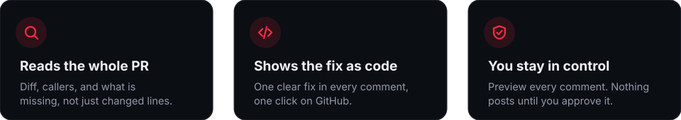
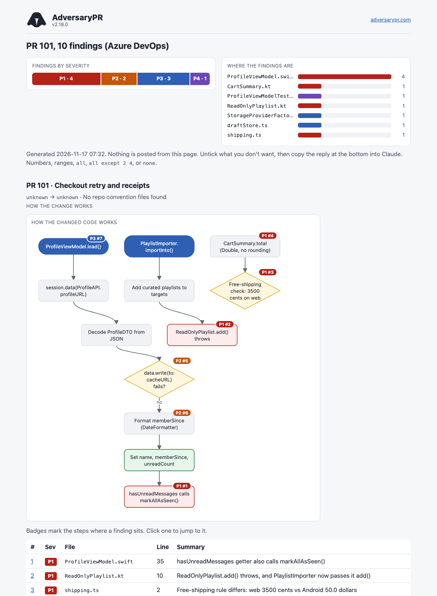
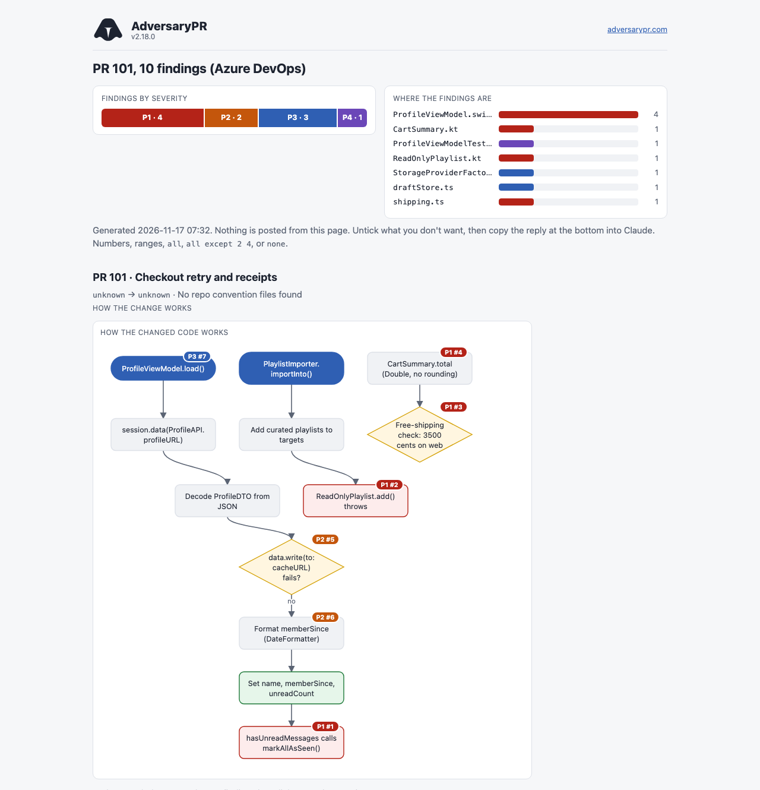
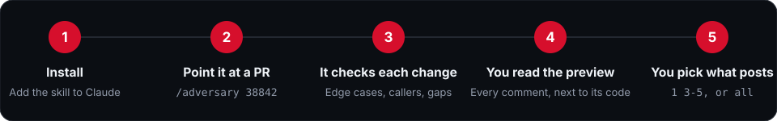

<p align="center">
  <picture>
    <source media="(prefers-color-scheme: dark)" srcset="assets/logo-horizontal-white.svg">
    <source media="(prefers-color-scheme: light)" srcset="assets/logo-horizontal-black.svg">
    
  </picture>
</p>

<h1 align="center">Write the best code in the universe</h1>

<p align="center">
  <strong>Built for AI PRs that keep coming.</strong><br>
  AI tools open pull requests faster than your team can review them. AdversaryPR is a Claude skill that gives you a faster, more confident review on Azure DevOps and GitHub: it reads the whole PR, drafts comments with the fix as code, and posts nothing until you approve it.
</p>

<p align="center">
  <a href="https://github.com/bugsworthai/adversary/releases/latest"></a>
  <a href="LICENSE"></a>
  
  
</p>

<p align="center">
  <a href="#install-and-use">Download</a> ·
  <a href="#what-a-comment-looks-like">See a sample comment</a> ·
  <a href="#how-a-review-runs">How it works</a> ·
  <a href="#free-and-open-source">Support</a>
</p>

<p align="center">
  <sub>Latest version <strong>2.19.0</strong> · package <code>adversary.skill</code> · command <code>/adversary</code> · free and open source</sub>
</p>

<p align="center">
  
</p>

---

## The problem

AI coding tools mean developers now open far more pull requests than before, and teams create them faster than people can review them.

- Some PRs cannot be reviewed in time. They sit for days and go stale.
- The longer a PR waits, the more likely it is to collide in a merge conflict.
- Work that depends on it stalls downstream.
- Reading a large AI-written PR closely takes real effort, and the reviewer is the bottleneck.

## The fix

AdversaryPR helps you keep up with the velocity of AI-written PRs. It gives you a faster, more confident way to review: it reads the whole pull request (the diff, the callers and what is missing), drafts inline comments that each name a failure or cost and show the fix as code, and shows the change visually (severity charts, a flowchart with findings pinned to steps, a PDF) so a PR is quick to understand. It can review several PRs at the same time. You pick what posts.

**What it does not do:** it never approves, merges or blocks a PR, never posts without your approval, does not run your code or tests, and does not replace human review or tests. It cannot catch everything. It makes each review quicker and more confident so fewer PRs sit; it does not manage your queue or fix merge conflicts.

## What it is

AdversaryPR is a careful reviewer for both sides of the code, on the author's side as well as yours.

- **It checks every change.** It asks "what if" about empty input, error paths, retries, concurrency, partial failure, upgrade and rollback. It compares the title, description, names, comments and passing tests with what the code does. It reads the callers, and it looks for what the diff is missing.
- **A clear reason and a fix in every comment.** Each comment sits on the exact line, gets to the point in plain words, asks the author a short question when it helps, names the failure scenario or cost, and shows one recommended fix as a code snippet.
- **Several PRs at once.** In Claude Code each PR gets its own background review agent, all running at the same time, and you approve from one combined preview.
- **Your languages and your repo's conventions.** Swift, Kotlin, Java, Python, Go and TypeScript, with design checks for SOLID (SRP in depth), DRY, YAGNI and an anti-pattern catalog. It also reads `CLAUDE.md`, `AGENTS.md`, `CONTRIBUTING.md` and Copilot instruction files from the PR's repo.
- **You stay in control.** You see a preview of every comment, then pick which ones go to the PR. Nothing posts until you approve it, and `dry run` posts nothing.

## What a comment looks like

This is a made-up export example. It is what lands on the line in your pull request.

> **Sam commented on line 6 of `/src/orders/export.ts`**
>
> **Possible crash on a missing order**
>
> `order.total` is read before checking that `db.orders.find` found the order. Can the order ever be missing?
>
> If an order is deleted after the export is queued, `find` returns `undefined`. Then `order.total` throws, and the export stops halfway through the file.
>
> Please take a look at the suggested fix below, unless this was intentional.
>
> ```ts
> const order = await db.orders.find(id);
> if (!order) { log.warn("order " + id + " not found, skipped"); continue; }
> await csv.write(order.total.toFixed(2));
> ```

Every comment has the same shape:

| Part | What it does |
|---|---|
| Title | Says the problem in a few words |
| Question (when it helps) | A short question, only when the author is the one who knows the answer, so they can say it was intentional |
| Failure | A concrete scenario or a named cost, never a vague "consider refactoring" |
| Lead-in | "Please take a look at the suggested fix below, unless this was intentional." |
| Fix | One recommended fix as a code snippet with the exact changed lines, or a pointer to a pattern already in your repo |

It is fair to both sides: it considers the author's side before it comments, and looks again if you disagree.

## Fix it in one click on GitHub

On GitHub, a fix can turn into a commit with one click. When the suggested fix replaces **exactly the lines the comment points at**, the skill posts it as a GitHub suggested change. GitHub then shows a **Commit suggestion** button on the comment, and **Add suggestion to batch** so you can put several fixes into one commit.

1. **Review.** Run `/adversary` on a GitHub PR and approve the comments you want. They post as one review with inline comments.
2. **Click.** Someone who can push to the PR branch opens the comment and clicks **Commit suggestion**, or **Add suggestion to batch** on several and then commits the batch.
3. **Done.** GitHub makes the commit on the PR branch.

How GitHub shows it:

```diff
@@ src/orders/export.ts @@
-    const order = await db.orders.find(id);
-    await csv.write(order.total.toFixed(2));
+    const order = await db.orders.find(id);
+    if (!order) { log.warn("order " + id + " not found, skipped"); continue; }
+    await csv.write(order.total.toFixed(2));
```

**[ Commit suggestion ]** **[ Add suggestion to batch ]**

The limits, so there are no surprises:

- If the fix does not replace exactly the lines the comment points at, it is posted as a normal code block, not a suggested change.
- On Azure DevOps there is no equivalent. The fix is a code block.
- The skill itself never commits or pushes code. The one-click commit is GitHub's own feature, done by the person who clicks the button.

## See every comment before it posts

Add `html` to a run (`/adversary 38842 ; html`) and the review opens as a web page. The chat also prints a link to it that you can click in your terminal. It is a calm place to read, change your mind, and choose.

<p align="center">
  
</p>

<p align="center">
  
</p>

- **Branded and visual.** The page opens with the AdversaryPR logo, name and version, and shows findings by severity and by file as charts.
- **A flowchart of how the code works.** Every page explains the changed code as a flowchart, drawn from the code that was read. Each finding is pinned to the step where it happens, as a badge you can click. Findings with a failure path can get their own small chart. They work offline and are never part of a comment.
- **Save it.** The skill saves `preview.pdf` next to the page, and the page's **Download PDF** button downloads it as a real PDF, with no print dialog. Each flowchart has a Save PNG button, and `--png` saves the whole page as one image.
- **Each comment next to its code.** The diff lines around the comment are highlighted, so you can judge it in context.
- **The comment as the pull request will show it,** and the exact markdown that will be posted.
- **A checkbox for every comment.** Untick what you don't want, then copy the reply (such as `1 3-5`) back into the chat.
- **Placement checks.** It flags a comment whose line isn't in the diff before anything is posted.
- **Safe.** It loads nothing from the network and cannot post.

## Works with

| Group | What | Notes |
|---|---|---|
| **Git hosts it reviews and posts to** | Azure DevOps<br><picture><source media="(prefers-color-scheme: dark)" srcset="assets/brands/github.svg"></picture> GitHub | Full flow: it fetches the pull request, reviews it, and posts inline comments after you approve. |
| **Where you run it** | <picture><source media="(prefers-color-scheme: dark)" srcset="assets/brands/claudecode.svg"></picture> Claude Code<br><picture><source media="(prefers-color-scheme: dark)" srcset="assets/brands/claude.svg"></picture> Claude apps | Claude Code in the terminal, and the Claude apps that accept skills. |
| **In your IDE** |  VS Code<br>Visual Studio<br><picture><source media="(prefers-color-scheme: dark)" srcset="assets/brands/jetbrains.svg"></picture> JetBrains | VS Code and JetBrains through Claude Code's IDE extensions. VS Code, Visual Studio and JetBrains through the GitHub Copilot port. |
| **Paste the review rules into** | <picture><source media="(prefers-color-scheme: dark)" srcset="assets/brands/githubcopilot.svg"></picture> GitHub Copilot<br><picture><source media="(prefers-color-scheme: dark)" srcset="assets/brands/cursor.svg"></picture> Cursor<br><picture><source media="(prefers-color-scheme: dark)" srcset="assets/brands/windsurf.svg"></picture> Windsurf<br><picture><source media="(prefers-color-scheme: dark)" srcset="assets/brands/googlegemini.svg"></picture> Gemini Code Assist<br><picture><source media="(prefers-color-scheme: dark)" srcset="assets/brands/coderabbit.svg"></picture> CodeRabbit<br><picture><source media="(prefers-color-scheme: dark)" srcset="assets/brands/gitlab.svg"></picture> GitLab<br><picture><source media="(prefers-color-scheme: dark)" srcset="assets/brands/bitbucket.svg"></picture> Bitbucket | The review rules also ship as a prompt for any tool that takes text. This group gets the rules as a prompt only. Posting to the pull request is Azure DevOps and GitHub only. |

<sub>Product names and logos are trademarks of their owners, shown only to say what AdversaryPR works with. No endorsement or affiliation is implied.</sub>

## Install and use

### Claude Code

[Download `adversary.skill`](https://github.com/bugsworthai/adversary/releases/latest/download/adversary.skill) from the latest release, unzip it into your skills folder, then type `/adversary` with a PR number or link (Azure DevOps or GitHub).

```bash
unzip adversary.skill -d ~/.claude/skills/
```

```text
/adversary 38842
```

### Claude apps

Upload `adversary.skill` where your organization manages Claude skills.

### GitHub Copilot

The Copilot port is separate from the skill. Copy the instruction and prompt files into your repo:

| From | To |
|---|---|
| `AdversaryPR/instructions/` | `.github/instructions/` |
| `AdversaryPR/prompts/adversary.prompt.md` | `.github/prompts/` |

`AdversaryPR/universal-prompt.md` is the same review rules as one prompt, for any tool that takes text.

### Commands

Options go after the first `;` and combine freely.

| Command | What it does |
|---|---|
| `/adversary 38842` | Review one PR with the latest version (2.19.0). |
| `/adversary 38842 ; html` | Latest, plus a web-page preview with each comment next to the code it points at. |
| `/adversary 38842 ; model=haiku` | Latest, reviewed by Haiku. Also `sonnet`, `opus`, `fable`. |
| `/adversary 38842 38901 39010 ; dry run` | Three PRs reviewed at the same time. Nothing is posted. |
| `/adversary https://github.com/acme/orders-api/pull/101 ; dry run` | A GitHub pull request, reviewed without posting. |

Together: `/adversary 38842 38901 ; dry run ; html ; model=sonnet`

### How a review runs

<p align="center">
  
</p>

1. Install the skill in Claude Code or your Claude app.
2. Point it at a PR: `/adversary 38842`.
3. It checks every change and drafts the comments, each with a clear reason and a suggested fix.
4. You review the preview.
5. You pick what posts, like `1 3-5` or `all`. `dry run` posts nothing.

| You type | What happens |
|---|---|
| `1 3-5` | Posts comments 1, 3, 4 and 5. |
| `all` | Posts every comment in the preview. |
| `dry run` (as an option) | Review only. Nothing is posted. |

The `html` preview loads nothing from the network and cannot post. On GitHub the comments post as one review with inline comments, as the signed-in user.

## Safe and predictable

- **Your token stays home.** All Azure DevOps and GitHub calls happen up front, in your session. The review agents never receive the token and never call either service. On GitHub it can use your `gh` CLI login, so there may be no token handling at all.
- **Several organizations?** Save one Azure DevOps token per organization, project or repo in `~/.ado-pr-review-creds.json` (owner-only), and each PR uses the right one. Add one with a hidden prompt, so the token never shows in the chat: `! python3 ~/.claude/skills/adversary/versions/2.15.0/scripts/creds.py add --org Contoso`. With several `gh` accounts, map an owner to one with `creds.py github-map --owner acme --gh-user alice`.
- **Nothing posts until you approve it.** You pick the comments. `dry run` posts nothing.

**Usage counts are opt-in.** Anonymous usage counts are off until you say yes. The skill asks once. If you agree, it sends the skill version and which options you used (dry run, html, model, pinned version) and nothing else: no code, no PR content, no repo or org names, no token. Turn it off any time. The counts go to a daily counter hosted on Google Firebase, so Google's servers see the connection like any website. The website also keeps a daily count of clicks on its download buttons, with no cookies and no IDs, and it stays off if your browser sends Do Not Track.

## Built for engineers

**Kind to people, careful with code.** Comments are clear and professional, about the change and never the person. The author can always say it was intentional. No sarcasm, no blame.

**Better engineers, one review at a time.** Each comment explains what could go wrong and why, then shows the fix, so every review is a short lesson and you pick up the failure patterns as you go. That is how it works. We have no measured improvement data yet, so we make no claim about results.

**Who builds it:** AdversaryPR is made by Bugsworth, LLC. It is free and open source under the MIT licence, and it was built with help from Claude, Anthropic's AI. Questions or ideas: [support@adversarypr.com](mailto:support@adversarypr.com).

**Questions, bugs, ideas?** [Open an issue on GitHub](https://github.com/bugsworthai/adversary/issues) or write to [support@adversarypr.com](mailto:support@adversarypr.com).

## Free and open source

AdversaryPR and its GitHub Copilot port are free and open source. Nobody pays to use them.

- **Licence:** code under the [MIT](LICENSE) licence, copyright Bugsworth, LLC. The name and logos are covered separately in [TRADEMARKS.md](TRADEMARKS.md).
- **Support:** questions, bugs or ideas are welcome at [support@adversarypr.com](mailto:support@adversarypr.com).
- **Hosted team endpoint:** coming. It is not live, and details and any pricing are not decided. Questions or news: [support@adversarypr.com](mailto:support@adversarypr.com).

## Latest release

| Version | Released | Highlights |
|---|---|---|
| **2.19.0** | 2026-11-17 | The HTML page downloads a real PDF (no print dialog) |
| 2.18.0 | 2026-11-17 | Every HTML page explains how the code works in a flowchart with findings pinned to steps; export to PDF or PNG |
| 2.17.0 | 2026-11-17 | Visual HTML preview: charts, flowcharts, AdversaryPR branding on the page |
| 2.16.0 | 2026-11-16 | Comments carry no footer or link by default |

## The story behind the helmet

Far from Earth, the Adavi world is under siege. The Bankuli hordes pour through every crack in its defenses, and its shield code can't keep up. So the Adversary, the Adavi leader, went looking for Earth's sharpest eyes: the coders who read someone else's code and ask "what if this is empty?" He shows you the fix, and never acts without your word. Every careful review is practice for the day he calls.

> *Coder. My world needs you. Will you stand at the gate?*

## Contributing

Tests run offline and never call Azure DevOps or GitHub. See [MIGRATION.md](MIGRATION.md) for setup, the release steps and the test prompt. Released versions are frozen: every change goes into a new version folder copied from the latest.

---

<p align="center"><sub>Open a pull request. Ship with confidence.</sub></p>
